> **Update (Oct 2026): Supabase has been removed.** Skillmark now runs on plain Postgres (Docker), PostgREST, its own cookie/JWT auth and local-disk storage. For the current setup, run commands and VPS deploy steps, see [docs/RUN.md](docs/RUN.md). Any Supabase instructions below are out of date.

<p align="center">
  <a href="https://aural-ai.com">
    
  </a>
</p>

<h1 align="center">Skillmark</h1>

<p align="center">
  <strong>Measure what matters.</strong><br/>
  Open-source AI interview platform for voice, chat, and video.
</p>

<p align="center">
  <a href="https://aural-ai.com">Website</a> &nbsp;·&nbsp;
  <a href="https://youtu.be/Mmn1tjTzuwQ">Video Intro</a> &nbsp;·&nbsp;
  <a href="https://aural-ai.com/docs">Docs</a> &nbsp;·&nbsp;
  <a href="#deployment">Deploy</a>
</p>

<p align="center">
  <a href="https://github.com/prateek-resiliencesoft/SkillMark"></a>
  <a href="LICENSE"></a>
  
  
  
  
</p>

<br/>

<p align="center">
  <a href="https://aural-ai.com">
    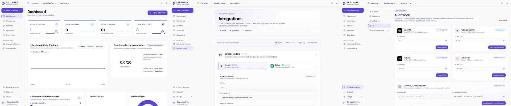
  </a>
</p>

<p align="center">
  Design an interview in plain language. Share a link. Skillmark's AI conducts the conversation —<br/>
  asking questions, probing with follow-ups, and generating detailed analysis when the session ends.
</p>

<p align="center">
  <b>
    <a href="https://aural-ai.com">Try Cloud &rarr;</a>
  </b>
  &nbsp;&nbsp;&nbsp;
  <b>
    <a href="#self-hosted">Self-Host Guide &darr;</a>
  </b>
</p>

---

### Key Capabilities

<table>
  <tr>
    <td width="25%" align="center"><strong>🎙 Voice, Chat & Video</strong><br/><sub>AI-driven interviews across all channels with real-time adaptation</sub></td>
    <td width="25%" align="center"><strong>🧠 AI Generation</strong><br/><sub>Describe goals in plain language — get a complete interview with questions and criteria</sub></td>
    <td width="25%" align="center"><strong>💻 Live Coding</strong><br/><sub>Monaco editor and Excalidraw whiteboard for technical assessments</sub></td>
    <td width="25%" align="center"><strong>📊 Auto Reports</strong><br/><sub>Per-question scores, highlights, and improvement areas generated by AI</sub></td>
  </tr>
  <tr>
    <td width="25%" align="center"><strong>🛡 Anti-Cheating</strong><br/><sub>Tab monitoring, paste blocking, multi-screen detection, integrity logs</sub></td>
    <td width="25%" align="center"><strong>👥 Team Management</strong><br/><sub>Organizations, projects, and role-based access control</sub></td>
    <td width="25%" align="center"><strong>🌐 Multilingual</strong><br/><sub>English and Chinese with pluggable locale system</sub></td>
    <td width="25%" align="center"><strong>🔌 Pluggable LLMs</strong><br/><sub>OpenAI, Gemini, Anthropic, NVIDIA, custom/local — keys in Settings → AI (env fallback)</sub></td>
  </tr>
  <tr>
    <td width="25%" align="center"><strong>📨 Messaging Integrations</strong><br/><sub>Email (Resend/Brevo), WhatsApp (ResilioHub), inbound/outbound webhooks</sub></td>
    <td width="25%" align="center"><strong>📝 Interview Form Integration</strong><br/><sub>Hosted apply forms, REST/MCP docs, API keys for ATS and careers sites</sub></td>
    <td width="25%" align="center"><strong>🔑 Developer API</strong><br/><sub>Full REST API with OpenAPI spec for programmatic interview management</sub></td>
    <td width="25%" align="center"><strong>📈 Activity Tracking</strong><br/><sub>Session activity segments and multi-segment audio recordings</sub></td>
  </tr>
</table>

---

## See Skillmark in Action

<p align="center">
  <a href="https://youtu.be/Mmn1tjTzuwQ">
    
  </a>
  <br/>
  <sub>Click to watch the 3-minute product demo on YouTube</sub>
</p>

<details>
<summary><strong>Influencer product promotion (Chinese)</strong></summary>
<br/>
<p align="center">
  <a href="https://youtu.be/iPZL9aWXp-Q">
    
  </a>
</p>
</details>

---

## Product Tour

Skillmark is an AI-powered interview platform that conducts structured interviews autonomously. You design an interview, share a link, and Skillmark's AI handles the conversation — asking questions, probing with follow-ups, and generating detailed analysis when the session is complete.

### Design Your Interview

Describe what you want to learn in plain language. The AI generates a complete interview with questions, assessment criteria, and recommended settings — or build one manually with the flexible editor.

<p align="center">
  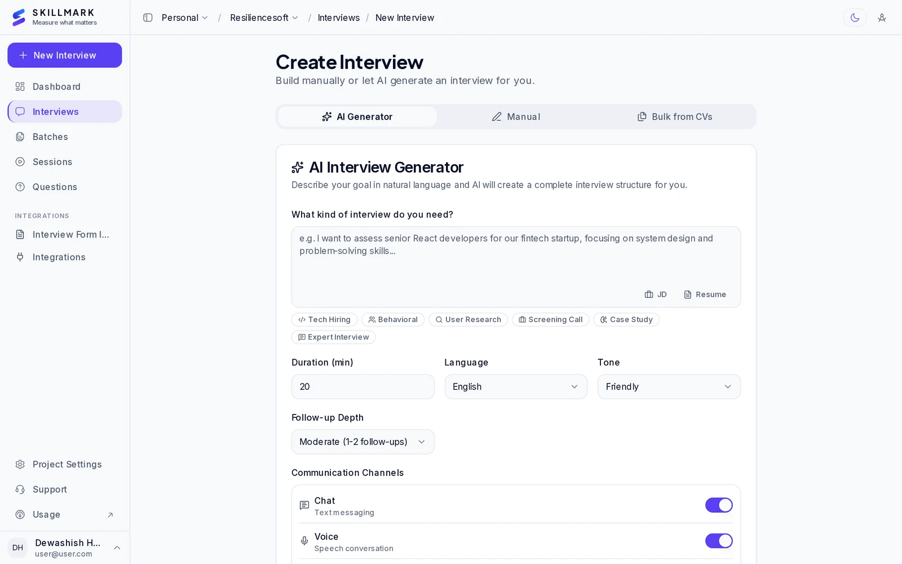
</p>

Customize questions by type: open-ended, single/multiple choice, live coding with Monaco editor, or whiteboard drawing with Excalidraw.

<p align="center">
  
</p>

### Configure & Share

Fine-tune interview settings — AI personality, tone, follow-up depth, language, and communication channels (chat, voice, video). Control access with public shareable links or invite-only mode.

<p align="center">
  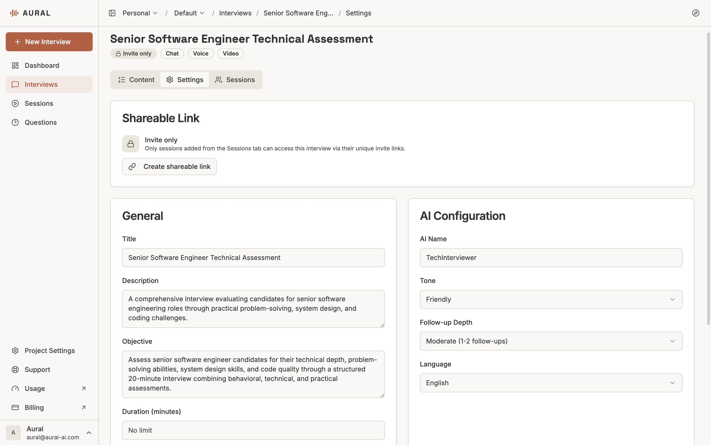
</p>

### Invite Candidates

Add candidates one at a time, bulk-import from an Excel spreadsheet, or upload PDF resumes and let AI extract the details. Each candidate gets a unique invite link.

<p align="center">
  
</p>

<table>
  <tr>
    <td width="50%">
      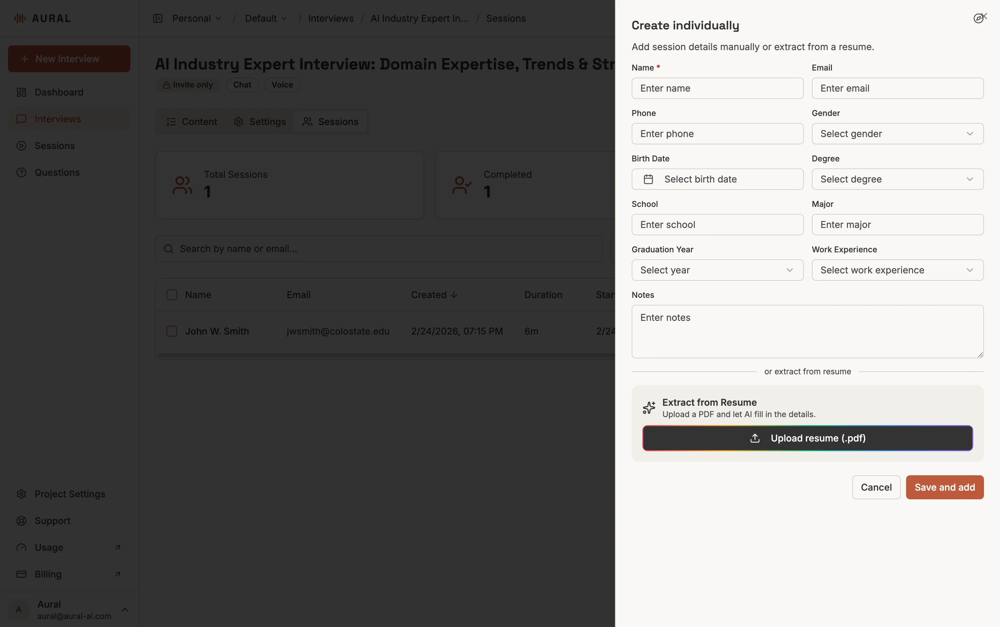
      <p align="center"><sub>Add a candidate manually or extract from resume</sub></p>
    </td>
    <td width="50%">
      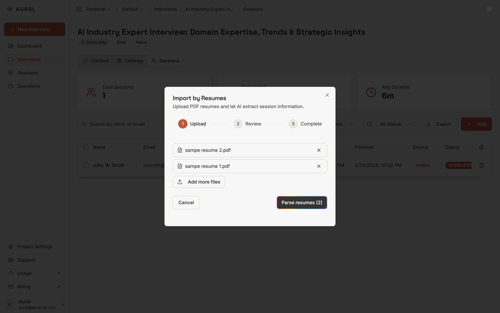
      <p align="center"><sub>Batch-import from PDF resumes</sub></p>
    </td>
  </tr>
</table>

### Candidate Experience

Candidates complete a pre-interview checklist (photo capture, microphone test, screen sharing) and then enter the live session.

<p align="center">
  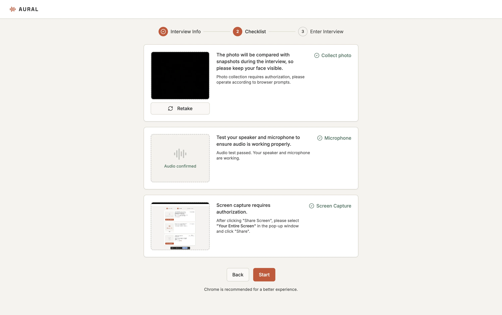
</p>

<p align="center">
  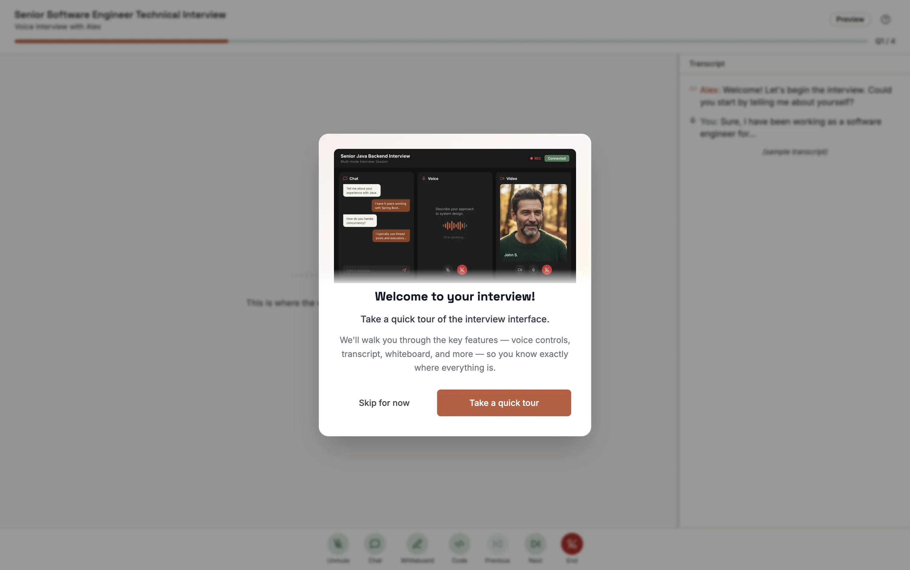
</p>

### Conduct the Interview

Share a link and candidates join via chat, voice, or video. The AI adapts in real time — adjusting follow-up depth, tone, and direction based on responses.

<p align="center">
  
</p>

Built-in coding and whiteboard modes for technical interviews:

<table>
  <tr>
    <td width="50%">
      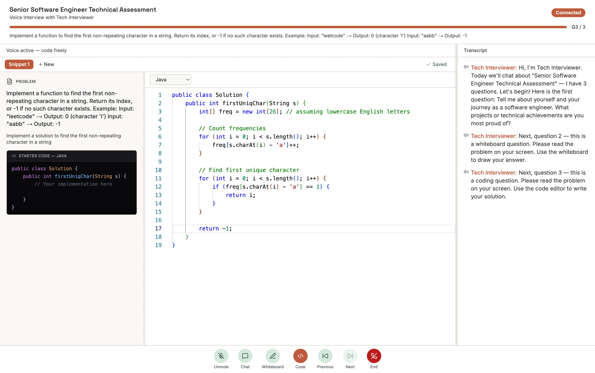
      <p align="center"><sub>Coding questions with Monaco editor</sub></p>
    </td>
    <td width="50%">
      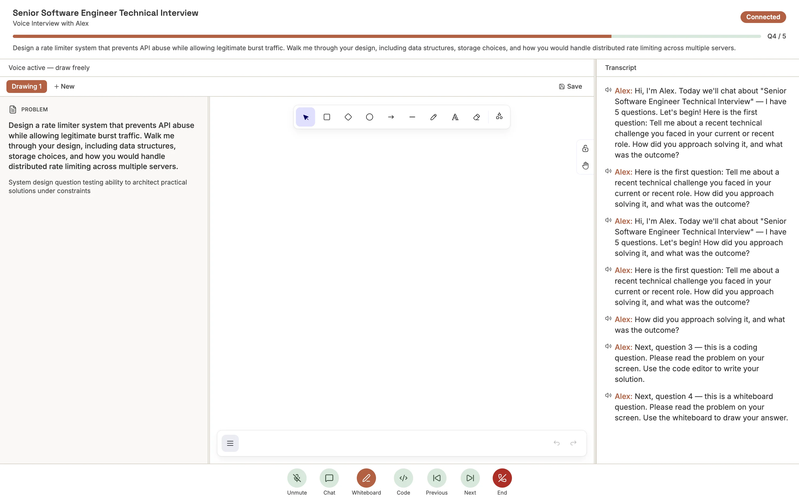
      <p align="center"><sub>Whiteboard questions with Excalidraw</sub></p>
    </td>
  </tr>
</table>

### Anti-Cheating

Enable anti-cheating mode to enforce camera, microphone, and screen sharing. The system monitors tab switches, blocks external paste, and detects multi-monitor setups — all logged in a per-session integrity report.

<p align="center">
  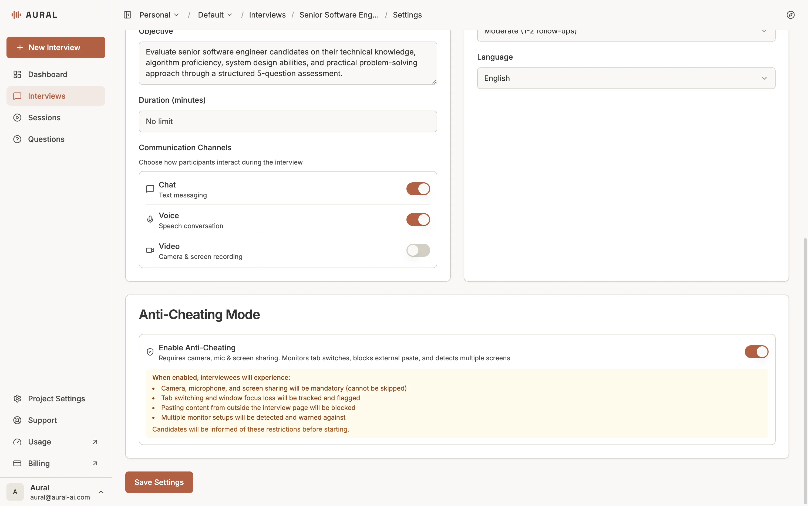
</p>

<table>
  <tr>
    <td width="50%">
      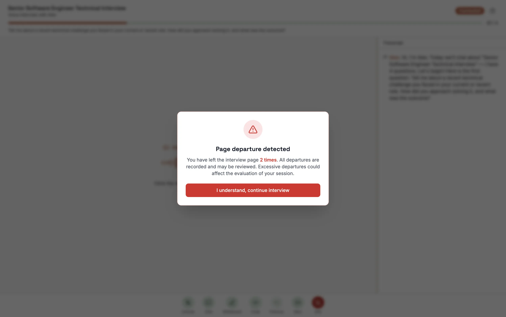
      <p align="center"><sub>Real-time violation warning</sub></p>
    </td>
    <td width="50%">
      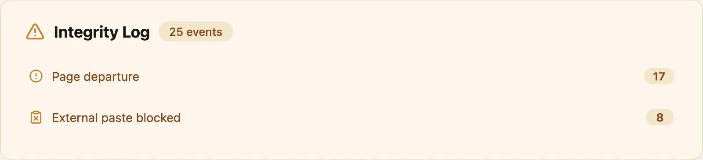
      <p align="center"><sub>Per-session integrity log</sub></p>
    </td>
  </tr>
</table>

### Analyze Results

Every completed session produces an AI-generated report with per-question scores, key highlights, and areas for improvement.

<p align="center">
  
</p>

<table>
  <tr>
    <td width="50%">
      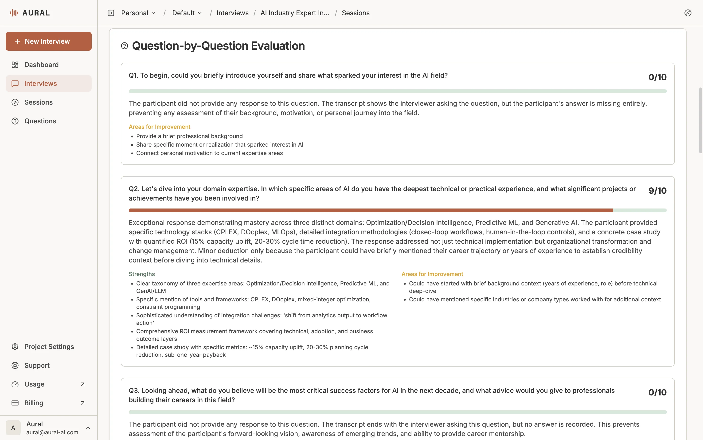
      <p align="center"><sub>Per-question evaluation</sub></p>
    </td>
    <td width="50%">
      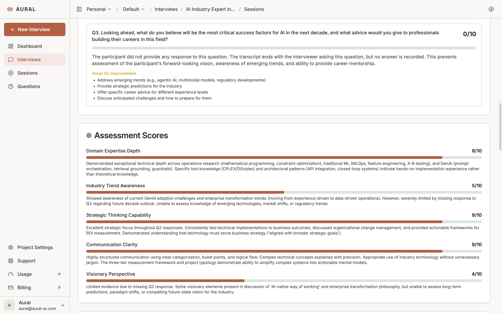
      <p align="center"><sub>Multi-dimensional assessment scores</sub></p>
    </td>
  </tr>
</table>

### Dashboard & Team Management

Track all your interviews, sessions, and candidates from a unified dashboard. Organize work across organizations and projects with role-based access.

<p align="center">
  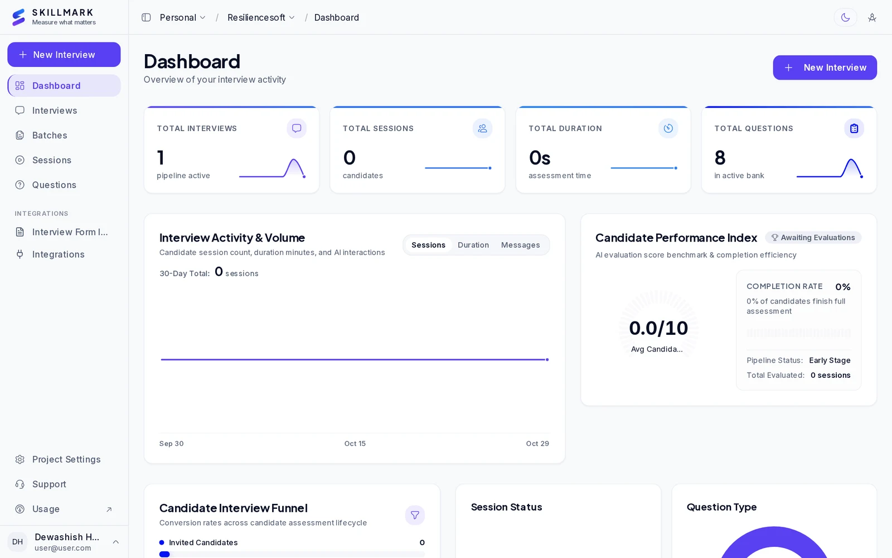
</p>

### Integrations & AI Keys

Connect email, WhatsApp, and webhooks from the **Integrations** sidebar. Configure LLM API keys under **Project Settings → AI** (org keys override `.env`).

<table>
  <tr>
    <td width="50%">
      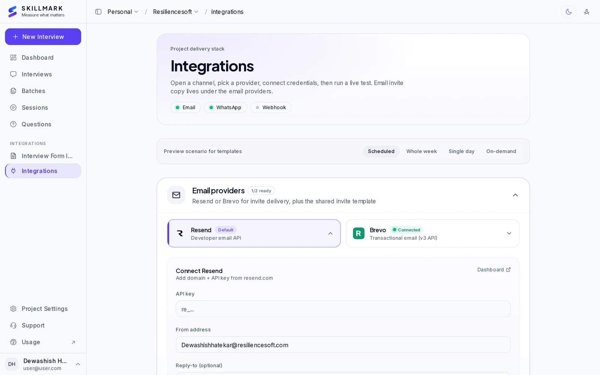
      <p align="center"><sub>Messaging integrations with sliding provider panels</sub></p>
    </td>
    <td width="50%">
      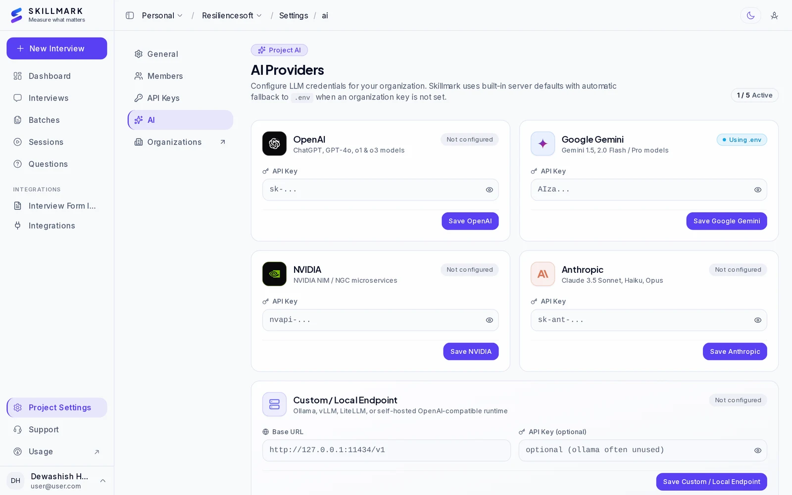
      <p align="center"><sub>Per-org AI provider keys (models stay server-side)</sub></p>
    </td>
  </tr>
</table>

<p align="center">
  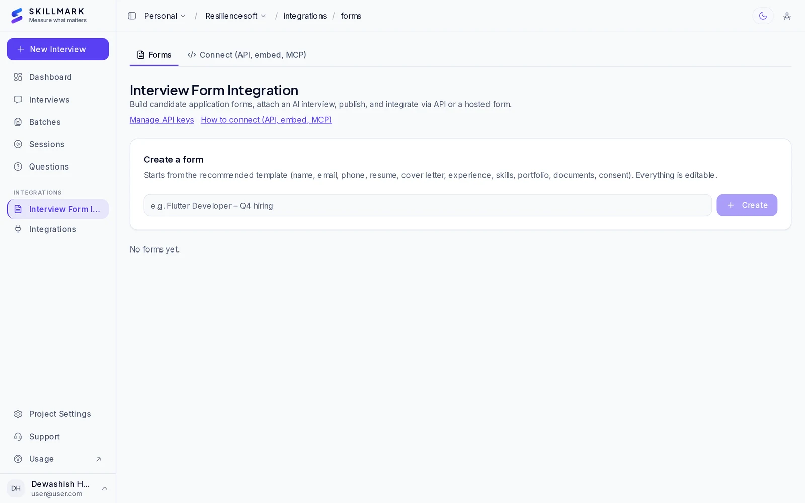
</p>

### Common Use Cases

- **Technical hiring** — coding and system design interviews with built-in editor and whiteboard
- **User research** — in-depth research interviews with AI follow-ups that surface deeper insights
- **Behavioral interviews** — voice-based conversations that feel natural and scale to hundreds of candidates
- **Interview practice** — candidates practice with AI feedback before their real interview

---

## Tech Stack

| Layer | Technology |
|-------|-----------|
| Framework | [Next.js 14](https://nextjs.org/) (App Router) |
| Language | TypeScript |
| Database | PostgreSQL + [PostgREST](https://postgrest.org/) (Docker Compose) |
| Auth | Cookie/JWT session (`AUTH_SECRET`) — no Supabase Auth |
| Storage | Local disk (`STORAGE_DIR`) |
| API | [tRPC](https://trpc.io/) + REST `/api/v1` |
| AI / LLM | OpenAI, Google Gemini, Anthropic, NVIDIA NIM, custom/local (Ollama), plus Kimi/MiniMax via env |
| Voice | WebSocket relays (Volcengine Doubao, Azure OpenAI Realtime, Gemini Live) |
| UI | [Tailwind CSS](https://tailwindcss.com/) + [shadcn/ui](https://ui.shadcn.com/) + [Radix](https://radix-ui.com/) |
| Code Editor | [Monaco Editor](https://microsoft.github.io/monaco-editor/) |
| Whiteboard | [Excalidraw](https://excalidraw.com/) |

---

## Architecture

```
┌──────────────────────────────────────────────────────────────┐
│                        Browser                               │
│  ┌───────────┐  ┌──────────────┐  ┌────────────────────────┐ │
│  │ Dashboard │  │ Interview    │  │ Session UI             │ │
│  │ & Admin   │  │ Builder      │  │ (Chat / Voice / Video) │ │
│  └─────┬─────┘  └──────┬───────┘  └──────────┬─────────────┘ │
│        │               │                     │               │
│        └───────────┬───┘         ┌───────────┘               │
│                    │             │ WebSocket                 │
└────────────────────┼─────────────┼───────────────────────────┘
                     │ tRPC / REST │
                     ▼             ▼
┌────────────────────────┐  ┌──────────────────┐
│   Next.js Server       │  │  Voice Relay     │
│                        │  │  Servers         │
│  ┌──────────────────┐  │  │  ┌────────────┐  │
│  │ tRPC Routers     │  │  │  │ Volcengine │  │
│  │ (typed RPC API)  │  │  │  │ Doubao S2S │  │
│  ├──────────────────┤  │  │  ├────────────┤  │
│  │ REST API Routes  │  │  │  │ Azure OAI  │  │
│  │ /api/ai/*        │  │  │  │ Realtime   │  │
│  │ /api/voice/*     │  │  │  └────────────┘  │
│  │ /api/auth/*      │  │  └──────────────────┘
│  ├──────────────────┤  │
│  │ AI Provider      │  │
│  │ Registry         │  │
│  │ ┌──────────────┐ │  │
│  │ OpenAI│Gemini│… │ │  │
│  │ └──────────────┘ │  │
│  └──────────────────┘  │
└────────────┬───────────┘
             │
             ▼
┌────────────────────────┐
│  Postgres + PostgREST  │
│  cookie/JWT auth       │
│  local-disk storage    │
└────────────────────────┘
```


### Key Modules

| Module | Location | Responsibility |
|--------|----------|----------------|
| **App Router** | `src/app/` | Pages and layouts organized into route groups: `(auth)` for login/register, `(dashboard)` for the main app, `(docs)` for documentation, and `i/` for public interview links. |
| **tRPC Routers** | `src/server/routers/` | Typed API layer handling interviews, sessions, analysis, organizations, projects, candidates, and access control. |
| **REST API Routes** | `src/app/api/` | Endpoints for AI operations (chat, generate, refine, summarize), voice token/save, auth, session lifecycle (complete/leave), and file uploads. |
| **Developer API (v1)** | `src/app/api/v1/` | Full REST API for programmatic interview management — CRUD for interviews, questions, sessions, candidates, publish, and usage. Authenticated via `dlv_` API keys with rate limiting. OpenAPI 3.1 spec at `/api/v1/openapi.json`. |
| **AI Provider Registry** | `src/lib/ai/` | Pluggable LLM system with a provider registry, per-task model selection, and prompt templates for interviewing, generation, and report summarization. |
| **Voice Relay** | `server/` | Standalone WebSocket servers that proxy audio between the browser and speech-to-speech APIs (Volcengine Doubao or Azure OpenAI Realtime). |
| **Components** | `src/components/` | React components split by domain — `session/` (chat/voice/video UI, anti-cheating), `interview/` (builder, question cards), `auth/`, `layout/`, and `ui/` (shadcn primitives). |
| **Data Layer** | `src/lib/supabase/` | PostgREST client helpers (legacy path names) for DB access; auth via cookie JWT; org-scoped access in tRPC routers. |
| **AI Settings** | `src/server/routers/aiSettings.ts` | Per-org encrypted LLM API keys (Settings → AI) with `.env` fallback. |
| **Messaging Integrations** | `src/app/(dashboard)/integrations/` | Email/WhatsApp providers, templates, webhooks; Interview Form Integration for apply forms + API/MCP docs. |

---

## Deployment

You can use Skillmark as a managed cloud service or self-host the entire platform on your own infrastructure.

### Self-Hosted (recommended)

Run Skillmark on your own servers with Docker Postgres + PostgREST.

#### Prerequisites

- **Node.js** 18+ and npm
- **Docker** + Docker Compose
- **LLM API key** — at least one provider (Settings → AI or `.env`)
- Optional voice relay credentials (Doubao / Azure OpenAI / Gemini)

#### 1. Clone and Install

```bash
git clone https://github.com/prateek-resiliencesoft/SkillMark.git
cd SkillMark
npm install
```

#### 2. Start database services

```bash
cp .env.example .env
# set POSTGRES_PASSWORD, AUTH_SECRET, and at least one LLM key
docker compose up -d
```

SQL under `db/init/` runs on first Postgres boot (schema, integrations, AI providers column, etc.).

#### 3. Start the app

```bash
npm run dev
# optional voice relays:
npm run dev:voice
npm run dev:openai-voice
npm run dev:voice:gemini
```

Open [http://localhost:3000/login](http://localhost:3000/login) or [http://localhost:3000/register](http://localhost:3000/register).

> **Note:** Managed cloud at [aural-ai.com](https://aural-ai.com) is the upstream Aural SaaS — Skillmark is the Resiliencesoft fork for self-host and customization.

---

## Project Structure

```
SkillMark/
├── src/
│   ├── app/                # Next.js App Router pages and API routes
│   │   ├── (auth)/         # Login, register
│   │   ├── (dashboard)/    # Dashboard, interviews, integrations, settings
│   │   ├── (docs)/         # Documentation pages
│   │   ├── api/            # AI, auth, voice, session, v1 REST
│   │   └── i/              # Public interview and invite links
│   ├── components/         # React UI by domain
│   ├── lib/ai/             # Provider registry + org credential resolve
│   ├── lib/messaging/      # Email/WhatsApp/webhooks
│   └── server/routers/     # tRPC (incl. aiSettings, integration)
├── server/                 # Voice relay WebSocket servers
├── db/init/                # Postgres bootstrap SQL
├── docker-compose.yml      # Postgres + PostgREST
├── tests/
└── public/
```

---

## AI Provider System

Skillmark uses a pluggable LLM provider architecture. Configure keys in **Project Settings → AI** (encrypted per organization) **or** via `.env`. Org keys win; empty org key falls back to env.

You need **at least one** provider. Default pick order: OpenAI → Gemini → NVIDIA → Anthropic → Custom/local → Kimi → MiniMax.

### Providers (Settings → AI)

| Provider | Env fallback | Notes |
|----------|-------------|-------|
| **OpenAI** | `OPENAI_API_KEY`, optional `OPENAI_BASE_URL` | Recommended default |
| **Google Gemini** | `GEMINI_API_KEY` or `GOOGLE_API_KEY` | OpenAI-compatible Gemini endpoint |
| **NVIDIA** | `NVIDIA_API_KEY` or `NGC_API_KEY` | NVIDIA NIM |
| **Anthropic** | `ANTHROPIC_API_KEY` | Claude Messages API |
| **Custom / local** | `CUSTOM_LLM_API_KEY`, `CUSTOM_LLM_BASE_URL` | Ollama, LiteLLM, vLLM, etc. |

Legacy env-only (not shown in Settings UI): `KIMI_API_KEY`, `MINIMAX_API_KEY`.

Models stay on the server (env defaults such as `OPENAI_MODEL`, `GEMINI_MODEL`, `ANTHROPIC_MODEL`) — the Settings UI only stores API keys / custom base URL.

### How LLMs Are Used

| Task | What It Does |
|------|-------------|
| **Chat interviewing** | AI interviewer during live sessions |
| **Interview generation** | Full interview from a plain-language brief |
| **Question refinement** | Improve questions from recruiter feedback |
| **Report & analysis** | Post-session scores, highlights, improvement areas |

---

## Voice Relay

Skillmark supports real-time AI voice interviews via WebSocket relay servers. Two relay implementations are provided.

> **Recommendation:** We strongly recommend using **Volcengine Doubao** as your primary voice relay. It delivers a noticeably better interview experience than the OpenAI Realtime model — lower latency, more natural speech-to-speech flow, superior Chinese language support, and built-in server-side auto-reconnect for reliability. The OpenAI relay is provided as a backup for environments where Volcengine credentials are unavailable.

### Primary (Recommended): Volcengine Doubao (`server/voice-relay.ts`)

The recommended voice relay for production use. It provides full-featured Speech-to-Speech capabilities with per-question interview flow, LLM-powered context summarization, native Chinese language support, and automatic server-side reconnection (up to 3 retry attempts with backoff) for resilient voice sessions.

```bash
npm run dev:voice          # starts on port 8081
```

**Required env vars:** `DOUBAO_APP_ID`, `DOUBAO_ACCESS_TOKEN`, `DOUBAO_SECRET_KEY`, `DOUBAO_APP_KEY`, `DOUBAO_RESOURCE_ID`

### Backup: Azure OpenAI Realtime (`server/openai-voice-relay.ts`)

An alternative relay using Azure OpenAI's Realtime API (`gpt-4o-realtime-preview`). Use this when Volcengine credentials are unavailable or for English-only deployments. Note that the OpenAI relay may have higher latency and less natural conversational flow compared to Volcengine.

```bash
npm run dev:openai-voice   # starts on port 8082
```

**Required env vars:** `AZURE_OPENAI_ENDPOINT`, `AZURE_OPENAI_API_KEY`, `AZURE_OPENAI_DEPLOYMENT`

> **Tip:** You can run both relays simultaneously. The frontend selects the appropriate relay based on the interview's language configuration.

---

## Developer API

Skillmark includes a full REST API for programmatic access to interviews, questions, sessions, and candidates. Use it to integrate Skillmark into your existing workflows, automate interview creation, or build custom integrations.

### Authentication

All API requests require a developer API key in the `Authorization` header:

```
Authorization: Bearer dlv_your_key_here
```

Create and manage API keys from **Settings > API Keys** in the dashboard.

### Endpoints

| Method | Path | Description |
|--------|------|-------------|
| `GET` | `/api/v1/interviews` | List interviews (paginated) |
| `POST` | `/api/v1/interviews` | Create interview |
| `GET` | `/api/v1/interviews/{id}` | Get interview with questions |
| `PATCH` | `/api/v1/interviews/{id}` | Update interview |
| `DELETE` | `/api/v1/interviews/{id}` | Archive interview |
| `POST` | `/api/v1/interviews/{id}/publish` | Publish interview (shareable link) |
| `GET/POST` | `/api/v1/interviews/{id}/questions` | List or add questions |
| `PATCH/DELETE` | `/api/v1/questions/{id}` | Update or delete a question |
| `GET` | `/api/v1/interviews/{id}/sessions` | List sessions (paginated) |
| `GET` | `/api/v1/sessions/{id}` | Get session with transcript |
| `GET/POST` | `/api/v1/interviews/{id}/candidates` | List or create candidates |
| `GET` | `/api/v1/usage` | Current usage snapshot |
| `GET` | `/api/v1/openapi.json` | OpenAPI 3.1 specification |

### Rate Limiting

API requests are rate-limited to 60 requests per minute per API key. Exceeded requests receive a `429` response with `Retry-After` header.

### Quick Example

```bash
# Create an interview
curl -X POST http://localhost:3000/api/v1/interviews \
  -H "Authorization: Bearer dlv_your_key" \
  -H "Content-Type: application/json" \
  -d '{"title": "Backend Engineer Screen", "voiceEnabled": true}'

# Add questions
curl -X POST http://localhost:3000/api/v1/interviews/{id}/questions \
  -H "Authorization: Bearer dlv_your_key" \
  -H "Content-Type: application/json" \
  -d '[{"text": "Describe your experience with distributed systems"}]'

# Publish and get shareable link
curl -X POST http://localhost:3000/api/v1/interviews/{id}/publish \
  -H "Authorization: Bearer dlv_your_key"
```

---

## Scripts

| Command | Description |
|---------|-------------|
| `npm run dev` | Start Next.js dev server |
| `npm run build` | Build for production |
| `npm run start` | Start production server |
| `npm run lint` | Run ESLint |
| `npm run test:web` | Run web tests |
| `npm run dev:voice` | Start primary voice relay (Volcengine Doubao) |
| `npm run dev:openai-voice` | Start backup voice relay (Azure OpenAI) |
| `npm run db:up` / `db:down` | Start/stop Postgres + PostgREST via Docker Compose |
| `npm run mediapipe:assets` | Fetch MediaPipe assets for head-movement detection |

---

## Contributing

Contributions are welcome! Please:

1. Fork the repository
2. Create a feature branch (`git checkout -b feature/amazing-feature`)
3. Commit your changes (`git commit -m 'Add amazing feature'`)
4. Push to the branch (`git push origin feature/amazing-feature`)
5. Open a Pull Request

---

## License

This project is licensed under the MIT License — see the [LICENSE](LICENSE) file for details.

---

## Credits & upstream

Skillmark is maintained by **Resiliencesoft** as a fork of the open-source **Aural** project.

- Official upstream: [github.com/1146345502/aural-oss](https://github.com/1146345502/aural-oss)
- Product site: [aural-ai.com](https://aural-ai.com)
- Built originally by [AuraTerra Nexus](https://aural-ai.com) — thank you for releasing Aural under MIT so the community can build on it.

We keep attribution and the MIT license intact. New Skillmark work (Postgres/PostgREST stack, Integrations UI, Settings → AI keys, Interview Form Integration, and related product changes) is developed by Resiliencesoft.

---

<p align="center">
  <sub>Built by <strong>Resiliencesoft</strong> team</sub><br/>
  <sub>Forked with credit from <a href="https://github.com/1146345502/aural-oss">Aural OSS</a> by AuraTerra Nexus</sub>
</p>
